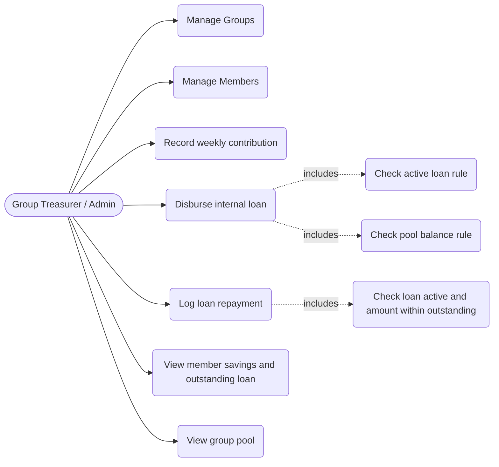
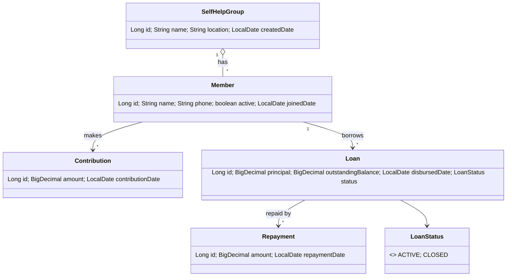
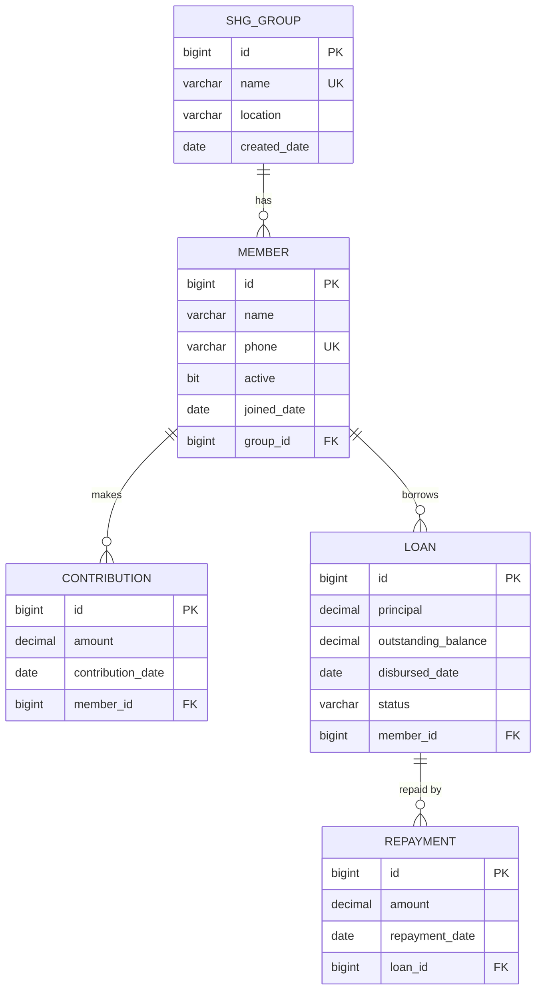
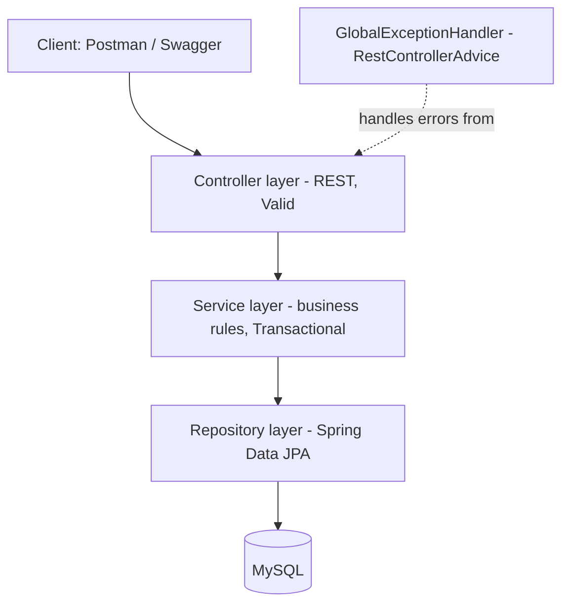
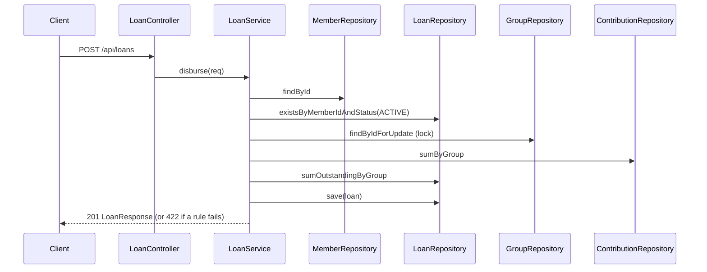

# MicroSave – Design Documents

## 1. Use case diagram

## 2. Class diagram

## 3. ER / schema diagram

## 4. Layered architecture

## 5. Sequence: disburse loan

## 6. Business rules
| Rule | Where enforced |
|---|---|
| Pool = total contributions - outstanding loans | GroupService.getPool, LoanService.disburse |
| Loan amount <= pool | LoanService.disburse (before save) |
| One active loan per member | LoanService.disburse (before save) |
| Repayment only on ACTIVE loan, <= outstanding | RepaymentService.repay |
| Loan auto-CLOSED at zero balance | RepaymentService.repay |
| Only active members can contribute or borrow | ContributionService / LoanService |
